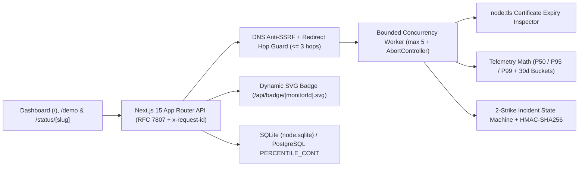

# PingPulse — Uptime Worker, Percentiles P50/P95/P99 & Status Pages

[](.github/workflows/ci.yml)

Standalone HTTP uptime monitor with DNS-resolved anti-SSRF + redirect hop validation, `PERCENTILE_CONT` telemetry parity, SSL/TLS certificate expiry inspection, dynamic SVG badges, 2-strike incident state machine with HMAC-SHA256 webhooks, interactive `/demo`, and public `/status/public` pages.

---

## 1. Architecture



---

## 2. Architecture Decision Records (ADRs)

1. **ADR-01 — DNS-Resolved Anti-SSRF with Manual Redirect Hop Inspection (`src/lib/ssrf.ts`, `src/core/worker.ts`)**: Every target URL and up to 3 `3xx` `Location` hops are validated via `dns.lookup` before opening a socket, blocking loopback (`127.0.0.0/8`, `::1`), RFC 1918, CGNAT (`100.64.0.0/10`), link-local/cloud metadata (`169.254.0.0/16`), IPv6 ULA (`fc00::/7`), `localhost`, and non-HTTP schemes.
2. **ADR-02 — 2-Strike Incident State Machine + HMAC-SHA256 (`src/core/incidents.ts`, `src/lib/webhooks.ts`)**: Transitions `UP -> DOWN` only after 2 consecutive failures to suppress transient packet loss, auto-resolves on recovery, and signs webhook payloads with `X-PingPulse-Signature`.
3. **ADR-03 — SQLite Local + PostgreSQL `PERCENTILE_CONT` Parity (`src/core/telemetry.ts`, `src/db/queries.pg.ts`)**: Local/test runs execute in-memory or file-backed `node:sqlite` via `drizzle-orm/sqlite-proxy`, while `queries.pg.ts` provides parameterized PostgreSQL `PERCENTILE_CONT(0.50/0.95/0.99) WITHIN GROUP (ORDER BY latency_ms)` for exact metric parity.

---

## 3. 3-Step Setup (`pnpm`)

```bash
pnpm install
pnpm db:migrate && pnpm db:seed
pnpm dev
```

Open `http://localhost:3007`, `/demo`, `/status/public`, or `/api/docs`.

---

## 4. Scaling Trade-offs (100 → 100k Monitors)

1. **In-Process Semaphore vs. Distributed Queue**: At 100–1k monitors, `runWithConcurrency(tasks, 5)` inside the API/worker process is zero-ops. At 100k monitors, probe jobs must move to a partitioned queue (BullMQ/SQS) with regional worker pools.
2. **SQLite WAL vs. Partitioned PostgreSQL/TimescaleDB**: Single-node SQLite handles ~1k heartbeats/sec cleanly. At 100k monitors (millions of heartbeats/day), time-partitioned PostgreSQL with `PERCENTILE_CONT` or continuous aggregates is required.
3. **On-Demand TLS Inspection vs. Cached Probe Metadata**: `inspectTlsCertificate` runs on diagnostic/card inspection with a strict timeout; at 100k monitors, TLS expiry should be persisted on each probe cycle and alerted via a dedicated expiry threshold.
