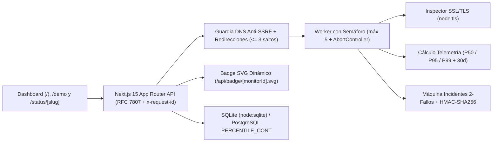

# PingPulse — Monitor de Uptime, Percentiles P50/P95/P99 y Páginas de Estado

[](.github/workflows/ci.yml)

Monitor HTTP de disponibilidad **standalone** con guardia anti-SSRF por resolución DNS (incluyendo saltos de redirección), paridad SQL con `PERCENTILE_CONT`, inspector de expiración de certificados SSL/TLS, badges SVG dinámicos, máquina de estados de incidentes de 2 fallos consecutivos con webhooks HMAC-SHA256, `/demo` interactiva y páginas públicas `/status/public`.

## Qué hace este proyecto

**PingPulse** vigila si tus sitios web o APIs están en línea y qué tan rápido responden. Mide latencias P50/P95/P99, revisa cuántos días le quedan al certificado SSL/TLS antes de vencer, abre incidentes automáticamente cuando detecta dos caídas seguidas (enviando alertas firmadas por webhook), genera un badge SVG embebible y publica una página de estado (`/status/public`).

---

## 1. Arquitectura



---

## 2. Decisiones Técnicas Clave (ADRs)

1. **ADR-01 — Anti-SSRF por resolución DNS con inspección manual de redirecciones (`src/lib/ssrf.ts`, `src/core/worker.ts`)**: Cada URL destino y hasta 3 saltos `3xx` (`Location`) se validan mediante `dns.lookup` antes de abrir conexión, bloqueando loopback (`127.0.0.0/8`, `::1`), RFC 1918, CGNAT (`100.64.0.0/10`), metadatos cloud (`169.254.0.0/16`), IPv6 ULA (`fc00::/7`), `localhost` y esquemas no HTTP.
2. **ADR-02 — Máquina de incidentes de 2 fallos consecutivos + HMAC-SHA256 (`src/core/incidents.ts`, `src/lib/webhooks.ts`)**: Cambia de `UP -> DOWN` únicamente tras 2 fallos seguidos para evitar falsos positivos por micro-cortes, se auto-resuelve al recuperarse y firma alertas con `X-PingPulse-Signature`.
3. **ADR-03 — Paridad SQLite local + PostgreSQL `PERCENTILE_CONT` (`src/core/telemetry.ts`, `src/db/queries.pg.ts`)**: Las demos y tests locales usan `node:sqlite` vía `drizzle-orm/sqlite-proxy`, mientras `queries.pg.ts` provee consultas parametrizadas `PERCENTILE_CONT(0.50/0.95/0.99) WITHIN GROUP (ORDER BY latency_ms)` para PostgreSQL 17.

---

## 3. Ejecución Local en 3 Pasos (`pnpm`)

```bash
pnpm install
pnpm db:migrate && pnpm db:seed
pnpm dev
```

Abre `http://localhost:3007`, `/demo`, `/status/public` o `/api/docs`.

---

## 4. Trade-offs Honestos (100 → 100k Monitores)

1. **Semáforo en proceso vs. cola distribuida**: Para 100–1.000 monitores, `runWithConcurrency(tasks, 5)` dentro del servidor es zero-ops; a 100k monitores los chequeos deben moverse a colas particionadas (BullMQ/SQS) con pools regionales.
2. **SQLite WAL vs. PostgreSQL particionado / TimescaleDB**: SQLite soporta ~1k heartbeats/s con facilidad; millones de registros diarios requieren tablas particionadas por tiempo y agregados continuos en PostgreSQL.
3. **Inspección TLS bajo demanda vs. persistencia por ciclo**: `inspectTlsCertificate` se ejecuta bajo demanda con timeout estricto; a escala de 100k monitores conviene persistir la caducidad en cada ciclo para alertar automáticamente antes del vencimiento.
